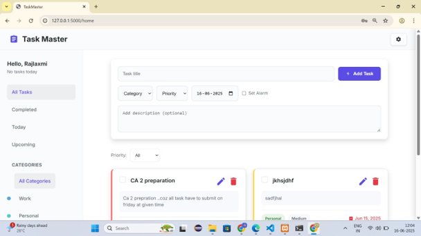
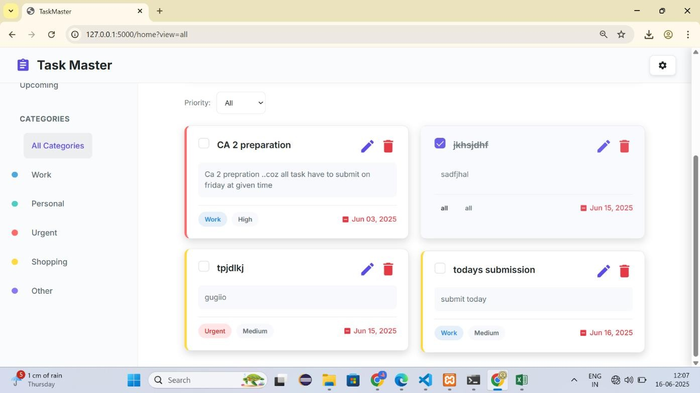
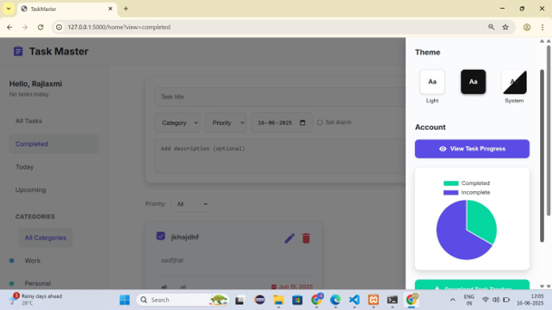
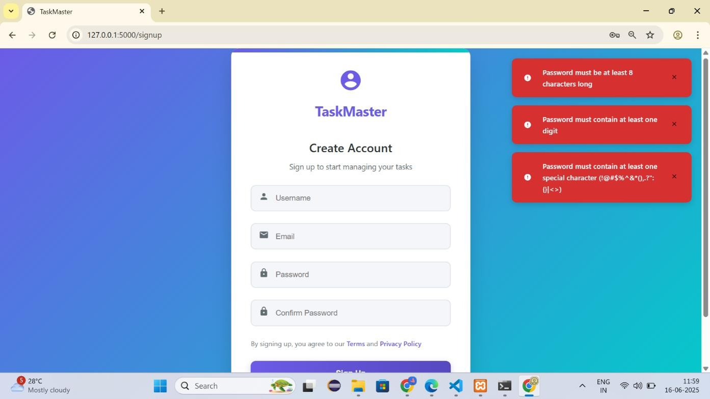

# Task Master

Task Master is a Flask-based task management web application designed to help users organize, prioritize, and track daily tasks efficiently. The application provides secure user authentication, task categorization, priority management, progress analytics, email reminders, and a modern responsive interface.

## Features

- User Registration and Login
- Secure Authentication System
- Create, Edit, and Delete Tasks
- Mark Tasks as Completed
- Task Categories Management
- Priority-Based Task Organization
- Task Progress Visualization using Pie Charts
- Email Reminder Notifications
- Forgot Password and Password Reset
- Dark Mode and Light Mode Support
- Responsive User Interface

---

## Tech Stack

### Backend
- Flask
- Python
- SQLAlchemy

### Frontend
- HTML
- CSS
- JavaScript
- Bootstrap

### Database
- SQLite / SQLAlchemy

### Additional Features
- Email Notifications
- Data Visualization
- Authentication & Session Management

---

## Screenshots

### User Dashboard



### Task Management



### Progress Analytics



### User Registration



---

## Project Structure

```text
task-master/
│
├── app.py
├── requirements.txt
│
├── migrations/
│
├── static/
│   ├── css/
│   └── js/
│
├── templates/
│
└── README.md
```

---

## Key Functionalities

### Task Management
Users can create, update, delete, and organize tasks based on priority and category.

### Progress Tracking
The application visualizes completed and pending tasks through graphical charts.

### Email Reminder System
Users can schedule reminders and receive notifications for upcoming tasks.

### Authentication & Security
The system includes secure login, registration, password validation, and password recovery mechanisms.

---

## Installation

```bash
git clone https://github.com/Rajlaxmi017/TaskMaster.git
cd task-master
pip install -r requirements.txt
python app.py
```

---

## Future Enhancements

- Calendar Integration
- Team Collaboration Features
- Mobile Application Support
- Advanced Productivity Analytics

---

## Author

**Rajlaxmi Raje**

